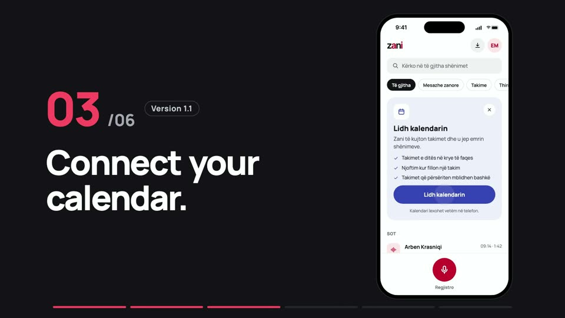
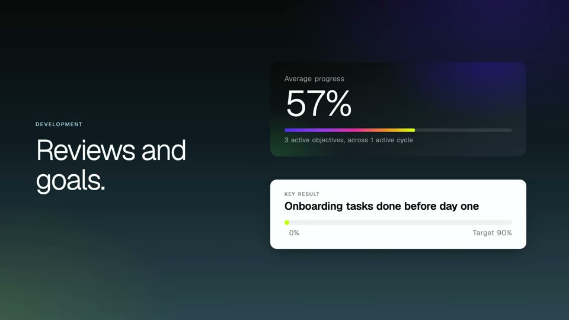
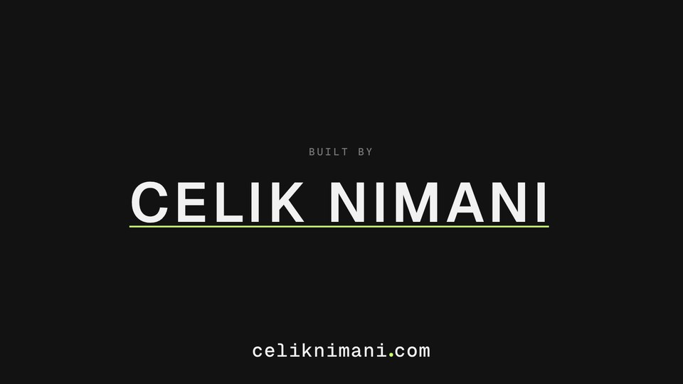
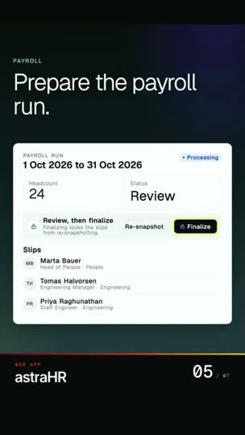

# Product Films

Celik Nimani's toolkit and process for making marketing videos in code: product and website films, Instagram Reels, paid social ads, sponsor overlay banners, 3D motion graphics, and films built around real footage.

Each video is an HTML timeline rendered frame by frame to MP4, with music composed in code and placed on the same timeline. Text, numbers and screens stay exact, and every sound lands on its cut.

## Overview

This folder is also a Claude Code skill. `~/.claude/skills/product-films` is a symlink to this folder, so Claude Code loads it whenever a video is requested, and any change made here changes the skill.

`SKILL.md` is the entry point for the agent: modes, defaults, the step-by-step process and the final report. The `references/` pages hold the detail for each mode and every lesson learned so far. `CHANGELOG.md` records what changed and why.

## Examples

Stills from films made with this toolkit.

| | |
| --- | --- |
|  |  |
| A product update beat on the real app screen (Zani, "What's new") | A feature beat rebuilt from the product's components (astraHR) |
|  |  |
| The kinetic close: the lime spark lands as the dot of celiknimani.com | A 9:16 Reel with the clip large above its label (astraHR) |

The checks sample every finished MP4 into a contact sheet, so a person can review a whole film at a glance.

## Quick start

```bash
PF=~/.claude/skills/product-films/scripts
FILM=~/Movies/product-films/my-film

bash $PF/setup.sh $FILM                      # film folder from the template
# write $FILM/src.html (scenes) and $FILM/score.py (music)
bash $PF/score.sh $FILM                      # master the music, check its length
python3 $PF/build.py $FILM my-film "My Film" # 16:9 and 9:16 pages
node $PF/preview.mjs $FILM/my-film-film.html $FILM/sheet-film.jpg 1 3 5
node $PF/text-still.mjs $FILM/my-film-film.html
bash $PF/render.sh $FILM my-film             # run in the background
~/.cache/product-film/venv/bin/python $PF/edge-check.py $FILM/my-film-film.mp4
```

To check the toolkit itself after changing a script or template, run `bash scripts/selftest.sh`. It builds the template film and a banner in a temp folder and runs every script and check (about a minute).

## Layout

| Path | What |
| --- | --- |
| `SKILL.md` | Modes, defaults, the 10-step film process, the final report |
| `CHANGELOG.md` | What changed in the toolkit and why |
| `references/ending.md` | The kinetic Celik Nimani end card: wipe bars, name, spark that lands as the dot of celiknimani.com |
| `references/pitfalls.md` | Every failure that reached a contact sheet, with its cause and fix |
| `references/music.md` | Writing a score with `soundkit.py`, mix targets, tempo changes |
| `references/brands.md` | Pulling a brand from a live site, masking personal data, known client brands |
| `references/footage.md` | Films built around real video and real sound |
| `references/overlay.md` | Sponsor banners with a transparent background, and which file to send a client |
| `references/ads.md` | Paid Instagram and Facebook ads: length, hook, safe zones |
| `references/3d.md` | three.js scenes, camera keys, instancing and morphs |
| `assets/stage.html` | The film template: timeline engine, helpers, capture hooks |
| `assets/overlay.html` | The sponsor banner template |
| `assets/score_example.py` | A working score |
| `scripts/` | Setup, music, build, preview, render, the automatic checks and `selftest.sh` |
| `docs/images/` | The screenshots in this README |
| `used.template.md` | Template for `private/used.md`, the log of every film made, so new films never repeat an intro, motif or score |
| `private/` | Your film log and client brand notes. Git ignores this folder |

## Requirements

macOS with ffmpeg, Node and Python 3 (`brew install ffmpeg node python`). `scripts/setup.sh` installs numpy, scipy, Playwright and Chromium into `~/.cache/product-film` on first use. That folder keeps the toolkit's earlier name on purpose: renaming it would reinstall Chromium for every existing film. `yt-dlp` is only needed for films that use the person's own online videos.

## Process

1. `scripts/setup.sh` creates the film folder from the template.
2. The agent reads the source (repo first, then the live site), writes `brief.md` with facts, a built check, contradictions and risks, and claims a new concept in `private/used.md`.
3. It builds the scenes in `src.html` and the music in `score.py`.
4. `scripts/score.sh` masters the music to -16 LUFS and refuses if the music and the page differ in length.
5. `scripts/build.py` writes the 16:9 film page and the 9:16 Reel page.
6. `scripts/preview.mjs` makes contact sheets, and `scripts/text-still.mjs` fails if any text moves after it lands.
7. Captions in a language other than English go to the person for review before rendering.
8. `scripts/render.sh` renders both formats at 1080p60 with sound. It stops if a capture worker fails or a frame is missing.
9. `scripts/check.sh` reports loudness and samples the final MP4s, and `scripts/edge-check.py` fails on any thin line along the frame edge.
10. The MP4s go to `~/Downloads`, the pages are published as private preview artifacts, and the film's row in `private/used.md` is completed.

Banners use `setup.sh <folder> overlay` and `scripts/overlay-render.sh` instead (see `references/overlay.md`).

## Locations

| What | Where |
| --- | --- |
| Toolkit and process | This folder |
| Each film's source, brief, score and check sheets | `~/Movies/product-films/<slug>/` |
| Delivered MP4s | `~/Downloads/` |
| Shared tools (Python venv, Playwright, Chromium) | `~/.cache/product-film/` |

`render.sh` keeps each film's `frames-film` and `frames-reel` folders (about 200 MB per 40 s film) for re-encoding. Delete them once a film is approved.

## Third-party assets

- **Fonts:** films load fonts from Google Fonts (Inter, Geist and others under the Open Font License). A client's licensed font may be used in the render but is never uploaded with a preview page.
- **three.js:** r128 from cdnjs, MIT licence (`references/3d.md`).
- **Stock footage:** Pexels clips are free for commercial use with no credit. Record each clip's source URL in the film's `brief.md` (`references/footage.md`).
- **People's own videos:** footage from a person's own channels, or from interviews they appear in, is used only with their approval in chat, and the source of each clip is listed in the brief.
- **Music:** every score is composed in code with `scripts/soundkit.py`, so there are no music licences to track.

## House rules

- Real screens and data only: features that exist only in a spec stay out, and contradictions on a client's site are reported, not shown.
- Text never moves after it lands, and nothing shows along the frame edges. The checks enforce both.
- Paid ads never name clients.
- Client films end on the Celik Nimani card. Films about Celik himself keep the motion and replace "Built by" with a call to action.
- Claude cannot hear the music, so Celik listens first. Every report says so.
- Nothing is posted publicly. Preview pages are private until shared.

The stills in this README come from Celik's own products (Zani and astraHR). Client work stays in `private/`.
